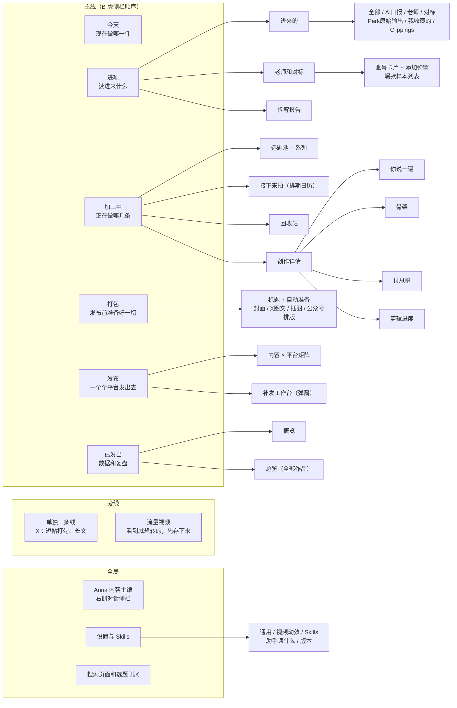
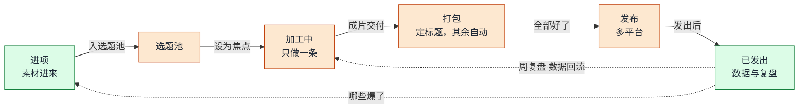
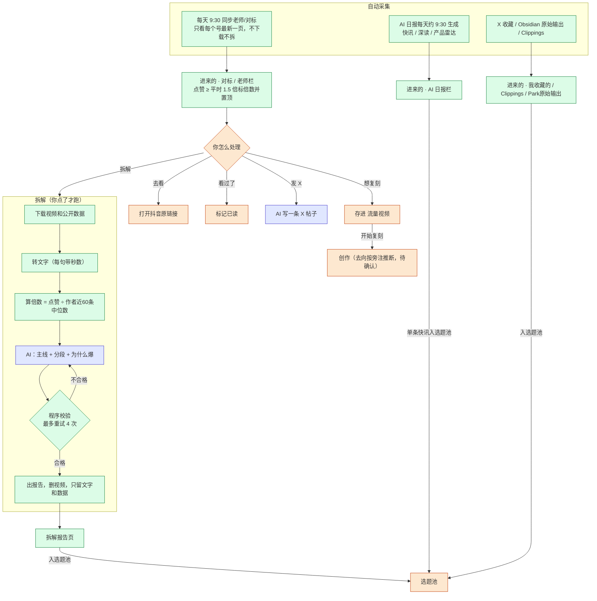
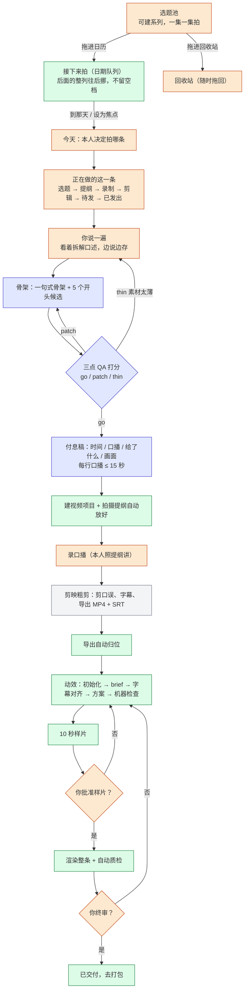
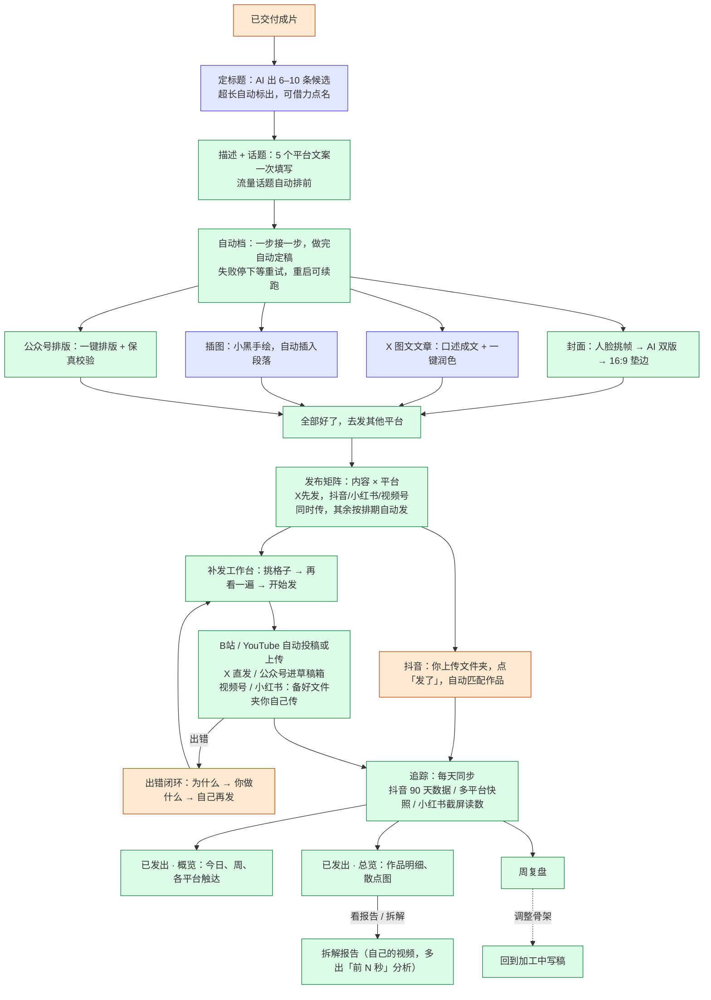
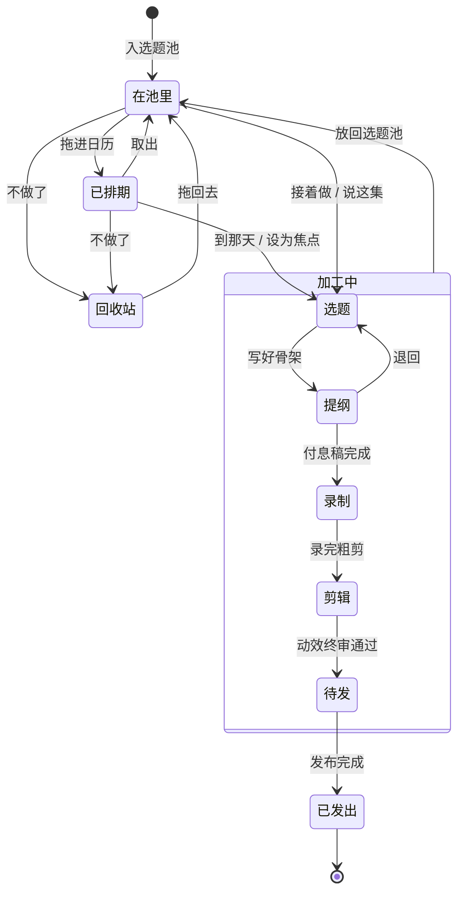

# 01 信息架构与主流程

> 第 1 期交付物之一。依据：32 张界面截图（U01–U32）、《工作台拆解》正文（D）、8 个开源仓库（码）。
> 证据标记：**图**=截图可见；**文**=正文描述；**码**=开源代码可查；**缺**=没有证据，复刻时需要你拍板。

## 0. 先说清三件事

1. **两版界面**。截图里有两套侧栏：
   - **A 版**（U01–U04）：今天、进项、排期、加工中、平台（抖音/视频号/小红书/X/其他）、汇总。
   - **B 版**（其余）：今天、进项、加工中、打包、发布、已发出，另有单独一条线(X)、流量视频、Anna、设置与 Skills。
   - **以 B 版为主线**；A 版独有的**排期日历**和**平台页**作为补充纳入，放进「加工中」和「发布」里。
2. **排除**：K 线日报、咨询客户、「我是谁 · 找到谁 · 卖什么」。侧栏里这三个入口不做。
3. **一次只做一条**是整套东西的总原则：选题池里有很多，但正在做的只有一条（焦点），其余等着。

---

## 1. 信息架构

### 页面清单

| # | 页面 | 入口 | 主要内容 | 证据 | 页面状态 |
|---|---|---|---|---|---|
| 1 | 进来的 | 进项 → 进来的 | 来源 Tab 原版共 8 个（全部、AI日报、K线日报、老师、对标、Park原始输出、我收藏的、Clippings），**K线日报按你的要求不做，复刻 7 个**；每条可「入选题池 / 发X / 展开原文」；对标条目有「去看 / 看过了 / 想复刻 / 拆解 / 发X」；3 / 7 / 30 天筛选 | 图 U05 U06 U12 | 有截图 |
| 2 | 老师和对标 | 进项 → 老师和对标 | 爆款门槛滑杆、时间/类型/排序筛选、账号卡片（走势图、中位、作品、爆款）、添加弹窗、爆款样本列表 | 图 U01 U07–U09 | 有截图 |
| 3 | 拆解报告 | 进项 → 拆解报告，或样本的「看报告」 | 左列最近/归档；右列 6 个指标格、主线、色带时间轴、逐段拆解、为什么爆 | 图 U10 U11 U13 U14；码 | 有截图 |
| 4 | 今天 | 侧栏「今天」 | 今日唯一要事、KPI 排序、AI 帮挑选题、周历/月历、连续出摊天数、周复盘 | 文 D02；A 版侧栏有「减 2」徽标 | **无截图** |
| 5 | 加工中（今天做哪一条） | 加工中 | 左：选题池和系列；右上：正在做的这一条（6 阶段条）；右下：接下来拍（日期队列） | 图 U15–U17 | 有截图 |
| 6 | 排期日历 | A 版「排期」；B 版并入加工中 | 七列月历、拖入排期、回收站、批量「写开头和骨架」 | 图 U02 | 有截图（A 版） |
| 7 | 创作详情 · 你说一遍 | 加工中「打开」 | 左：来源拆解；右：口述编辑，自动保存、删口水话、存进原始输出 | 图 U18 U19 | 有截图 |
| 8 | 创作详情 · 骨架 | 同上 Tab | 评分（如 7/15）与重评、预览/编辑、开头候选、证据（按论点找证据） | 图 U20 U21 | 有截图 |
| 9 | 创作详情 · 付息稿 | 同上 Tab | 时间 / 口播 / 这句给了什么 / 画面 四列表 | 图 U22 | 有截图 |
| 10 | 创作详情 · 剪辑进度 | 同上 Tab | 新建或关联项目文件夹、14 步初始化、素材/产物/进程状态 | 图 U23 U24；码 koubo | 有截图 |
| 11 | 打包 | 打包 | 标题 + 自动准备 4 项（封面、X图文、插图、公众号排版）+ 描述话题 | 图 U25 | 有截图 |
| 12 | 发布 | 发布 | 内容 × 7 平台矩阵，补发/不补发，下载表格 | 图 U26 | 有截图 |
| 13 | 补发工作台 | 发布 → 打开补发工作台 | 第 1 步挑格子；后两步（预览、开始发）无截图 | 图 U27；后两步 **缺** | 部分 |
| 14 | 平台页（抖音） | A 版侧栏平台 | 待发、今日触达、近 12 条已发、被删/被限流记录、平台设置 | 图 U03 | 有截图（A 版） |
| 15 | 已发出 · 概览 | 已发出 | 今日/周触达、各平台卡片、往日日结、内容×平台累计触达 | 图 U28 | 有截图 |
| 16 | 已发出 · 总览 | 已发出 → 总览 | 5 项 KPI、时长×播放散点图、作品明细表 | 图 U29 U30 | 有截图 |
| 17 | 单独一条线 | 侧栏 X | 短帖打勾、长文 | 图 U05 侧栏仅见入口；文 D07 | **无截图** |
| 18 | 流量视频 | 侧栏 | 贴链接存下来、卡片（为什么想转、归哪个合集、开始复刻） | 图 U31 | 有截图 |
| 19 | Anna | 侧栏，右侧对话 | 带「正在看哪个页面」的上下文，清空 / 去忙吧 | 图 U32 U02 | 有截图 |
| 20 | 设置 | 设置与 Skills | 5 个 Tab；视频动效 Tab 有预设、三个参数、样式图鉴 | 图 U04；码 settings.yaml | 仅 1 个 Tab 有截图 |
| 21 | 平台页（其余） | A 版侧栏 | 视频号、小红书、X、其他三个 | 图只见徽标；**缺** | **无截图** |

**无截图的页面共 4 个**（今天、单独一条线、其余平台页，加上补发工作台后两步），第 2 期先做空壳，规则由你定。

---

## 2. 一条内容的一生（总览）

图例：橙=主要由你操作；蓝=AI；绿=自动。细节见下面三张分段图。

---

## 3. 分段流程

三张图里的颜色：橙 = 人，蓝 = AI，绿 = 自动程序，灰 = 外部工具。

### 3.1 进项 → 选题池

要点：
- 「想复刻」只是存进流量视频；真正开始创作是在流量视频卡片上点「开始复刻」（旁注说跳创作页，去向**待确认**）。
- 同步**不下载不拆解**；只有你点「拆解」才进下载。倍数门槛有三处，各管各的（**码**）：课程 ≥ 2×；进项高亮 ≥ 1.5×；对标页滑杆可调（截图里 4× 和 2.5×）。
- 不给倍数：作者不到 20 条，或中位数不到 50 赞。

### 3.2 加工中 → 成片

要点：
- 「一次只做一条」：焦点卡只有一张，其余在选题池里等。
- 稿子（骨架、QA、付息稿）**没有开源实现**，是第 4 期要和你一起定规则的部分。
- 动效有 **3 个人工审批门**（码 koubo）：Hook、视觉规格、成片。截图和正文只明确了样片批准和终审，Hook 门正文里没写，**待确认**要不要。
- 退回：样片/终审不通过回到哪一步，原版**缺**，上图是我的假设，第 2 期前请你确认。

### 3.3 打包 → 发布 → 复盘

要点：
- 发布有四种方式，不能统一成「手动发」：自动投稿（B站、YouTube）、直发（X）、进草稿箱（公众号，你去群发）、备好文件夹你自己传（视频号、小红书）。
- 补发工作台只有第 1 步（挑格子）有截图，预览和开始发两步**缺**。
- 复刻**只记录原版行为**。任何会真实对外发布的动作，第 6 期做时保留人工确认。

---

## 4. 选题的状态

截图 U17 的阶段条给出 6 个阶段；位置（池 / 日历 / 回收站）是另一条线，两条线同时存在。

**注意两处阶段条不一致**：加工中页（U17）是「选题 → 提纲 → 录制 → 剪辑 → 待发 → 已发出」6 段；进入详情后（U18 起）是「骨架 → 录制 → 剪辑 → 待发 → 已发出」5 段，「选题」「提纲」合并成「骨架」。复刻时以哪个为准，第 3 期定。

**转移条件说明**：下图里只有「退回」「放回选题池」「拖进日历」「拖进回收站」有截图依据；「写好骨架」「付息稿完成」「录完粗剪」「动效终审通过」这几个触发条件是**我的推测**，原版没写明。

状态依据：阶段条 **图 U17**；入池、排期、回收站 **图 U02 U15 U16**；「退回提纲」「放回选题池」 **图 U17**。
**缺**：「阶段自动推断」按什么条件判断（正文只写「自动推断」），第 3 期设计状态机时需要你拍板。

---

## 5. 谁做什么（人 / AI / 自动）

| 阶段 | 你（人） | AI | 自动程序 |
|---|---|---|---|
| 进项 | 看、点「拆解」、选题 | 拆结构、写 X 帖子 | 同步对标、日报、下载、转写、算倍数、校验 |
| 加工中 | 决定拍哪条、口述、录口播、粗剪、批准样片、终审 | 骨架、开头候选、QA 打分、付息稿 | 建项目、导出归位、动效渲染、机器检查 |
| 打包 | 选标题 | 标题候选、X 文章、插图 | 描述话题、封面、公众号排版、自动档 |
| 发布 | 抖音上传、点「发了」、挑格子、视频号/小红书手动传 | — | 匹配作品、B站/YouTube/X 自动发、出错提示 |
| 已发出 | 看、复盘 | 拆自己的视频 | 每日同步、快照、统计 |

---

## 6. 本期遗留（需要你拍板或后续补）

| # | 问题 | 影响 | 建议 |
|---|---|---|---|
| 1 | 4 个页面没有截图：今天、单独一条线、其余平台页、补发工作台后两步 | 第 2 期先做空壳 | 你说规则，或先留空 |
| 2 | 样片/终审不通过后退回哪一步 | 状态机 | 先按「退回动效方案」，你可改 |
| 3 | Hook 审批门要不要保留 | 剪辑流程 | 你自己视频是否剪 Hook |
| 4 | 「想复刻」「开始复刻」之后进创作的哪一步 | 进项到加工中的衔接 | 先按「进你说一遍，带着拆解当底稿」 |
| 5 | 阶段自动推断规则 | 状态机 | 第 3 期设计 |

**下一步**：`docs/02-数据契约.md`（「一条选题」的字段和状态）和 `docs/03-我的改动清单.md`（你对照本文标注哪里要不一样）。
